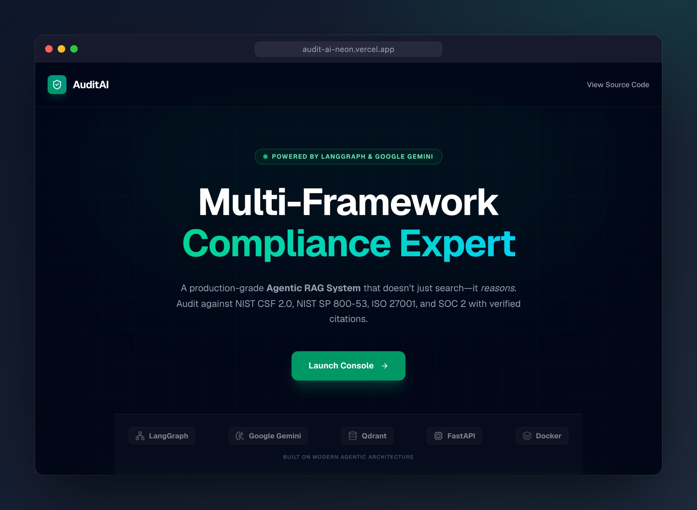
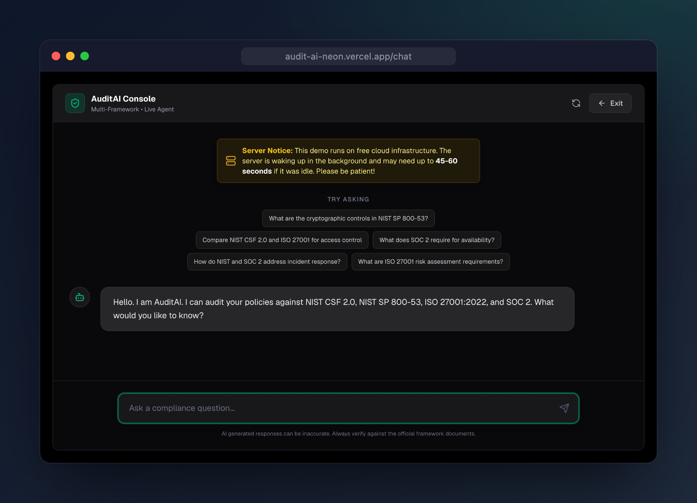
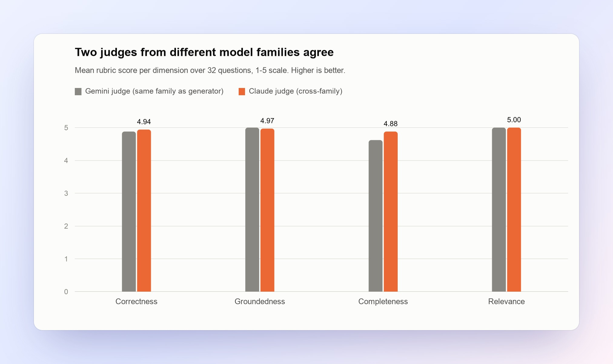
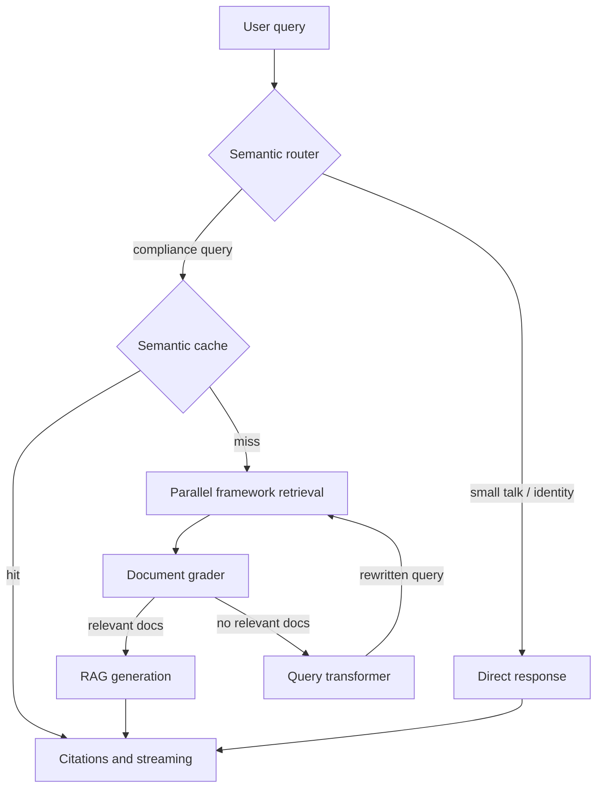

<div align="center">

# AuditAI

**Agentic RAG that audits against four cybersecurity frameworks, with page-level citations and 0.98 RAGAS faithfulness.**

    

[**Live demo**](https://audit-ai-neon.vercel.app) · [Results](#results) · [Architecture](#architecture) · [Run it](#running-locally)



<br>

<table>
<tr>
<td align="center" width="25%"><b>4</b><br><sub>frameworks indexed</sub></td>
<td align="center" width="25%"><b>0.978</b><br><sub>RAGAS faithfulness</sub></td>
<td align="center" width="25%"><b>1.000</b><br><sub>RAGAS context recall</sub></td>
<td align="center" width="25%"><b>2</b><br><sub>judge families agree</sub></td>
</tr>
</table>

</div>

---

## What it does

AuditAI answers compliance questions against **NIST CSF 2.0**, **NIST SP 800-53**, **ISO 27001:2022** and **SOC 2 Trust Services Criteria**. Every claim is traced to a framework name and PDF page number.

Unlike a plain RAG pipeline, it runs a self-correcting graph (Corrective RAG): retrieved chunks are graded, and weak retrievals get the query rewritten and retried before anything is generated.

<table>
<tr>
<td width="52%" valign="top">

**How it behaves**

- **Parallel retrieval.** One concurrent search per framework, so a long PDF cannot crowd out a short one.
- **Graded context.** Each chunk is scored for relevance; all grades run concurrently.
- **Self-correcting.** Failed retrievals are rewritten with domain terms, up to 3 retries.
- **Cited answers.** Framework plus page number on every source card.
- **Streams tokens** over SSE as they are generated.
- **Semantic cache** skips the graph on near-duplicate queries.

</td>
<td width="48%" valign="top">



</td>
</tr>
</table>

## Results

Evaluated on 32 questions spanning all four frameworks plus cross-framework comparisons.

### RAGAS

| Metric | Score |
| :--- | :--- |
| **Faithfulness** | `0.9783` |
| **Answer Relevancy** | `0.7847` |
| **Context Precision** | `0.7887` |
| **Context Recall** | `1.0000` |

Per-question breakdown: [evals/ragas_report.md](evals/ragas_report.md).

### Cross-family LLM-as-judge

RAGAS uses Gemini as its internal judge, the same family that generates the answers. That risks self-preference bias, so a second rubric-based judge from a different family grades every answer 1 to 5 on four axes.

<div align="center">

</div>

| Dimension | Gemini judge | Claude judge (independent) |
| :--- | :--- | :--- |
| **Correctness** | `4.88` | `4.94` |
| **Groundedness** | `5.00` | `4.97` |
| **Completeness** | `4.62` | `4.88` |
| **Relevance** | `5.00` | `5.00` |

- The two judges land within about 0.25 on every dimension.
- The Claude judge originally exposed a verbosity defect (relevance `4.12`) that the Gemini judge masked at `5.00`. Tightening the generation prompt and upgrading the generator closed the gap.
- Judges: [`evals/judge.py`](evals/judge.py) (`gemini-2.5-flash-lite`) and [`evals/judge_claude.py`](evals/judge_claude.py) (`claude-sonnet-5`, needs `ANTHROPIC_API_KEY`). Report: [evals/judge_claude_report.md](evals/judge_claude_report.md).

## Architecture



| Piece | What it does |
| :--- | :--- |
| **Semantic router** | Fast LLM classifier; bypasses vector search for greetings and identity questions |
| **Parallel retrieval** | 4 concurrent `ThreadPoolExecutor` searches, one per framework (k=4 each, 16 chunks) |
| **Document grader** | Scores each chunk for relevance, all in parallel via `asyncio.gather` |
| **Query transformer** | Rewrites failed queries with domain terminology, loops back up to 3 times |
| **Semantic cache** | Qdrant-backed, cosine threshold 0.93; skips the graph on near-duplicates |
| **Hallucination control** | Page-level citations, temperature 0, citation cards suppressed on refusals |

| Component | Technology |
| :--- | :--- |
| **Orchestration** | LangGraph (stateful CRAG graph) |
| **LLM** | `gemini-3.5-flash` |
| **Embeddings** | `gemini-embedding-001` |
| **Vector DB** | Qdrant Cloud (payload-indexed per framework) |
| **API** | FastAPI + SSE streaming (NDJSON) |
| **Frontend** | Next.js 16, Tailwind CSS v4, Framer Motion |
| **Deployment** | Render.com (backend) + Vercel (frontend) |

Streaming format:

```json
{"type": "token", "content": "The"}
{"type": "sources", "content": [{"file": "NIST SP 800-53", "page": 335, "text": "..."}]}
```

## Knowledge base

| Framework | Focus |
| :--- | :--- |
| **NIST CSF 2.0** | High-level cybersecurity framework (Govern, Identify, Protect, Detect, Respond, Recover) |
| **NIST SP 800-53** | Detailed security and privacy controls catalog |
| **ISO 27001:2022** | International ISMS standard, risk-based approach |
| **SOC 2 TSC** | AICPA Trust Services Criteria: security, availability, confidentiality, privacy |

## Running locally

Create `.env` in the project root:

```bash
GOOGLE_API_KEY=<key from https://aistudio.google.com/app/apikey>
QDRANT_URL=<your Qdrant Cloud URL>
QDRANT_API_KEY=<your Qdrant Cloud API key>

# Optional, only for the cross-family judge (evals/judge_claude.py)
ANTHROPIC_API_KEY=<key from https://console.anthropic.com>
```

```bash
uv sync
uv run python src/audit_ai/rag/ingestion.py        # index PDFs from data/ (recreates the collection)
uv run uvicorn audit_ai.api.main:app --reload      # backend on :8000
cd frontend && npm install && npm run dev          # frontend on :3000
```

<details>
<summary><b>Evaluation pipeline</b></summary>

<br>

```bash
uv sync --group evals
uv run python evals/collector.py     # collect answers -> rag_results.json
uv run python evals/evaluator.py     # RAGAS metrics -> ragas_report.md
uv run python evals/judge.py         # Gemini judge -> judge_report.md
uv run python evals/judge_claude.py  # cross-family Claude judge -> judge_claude_report.md
```

`judge_claude.py` needs `ANTHROPIC_API_KEY`. All three scorers read the same `rag_results.json`, so run `collector.py` first, then any scorer in any order.

</details>

<details>
<summary><b>Project structure</b></summary>

<br>

```text
audit-ai/
├── src/audit_ai/
│   ├── config.py            # API keys, model names, tuning knobs
│   ├── rag/
│   │   ├── engine.py        # LangGraph CRAG graph, router, semantic cache
│   │   └── ingestion.py     # Multi-PDF ingestion with Qdrant payload index
│   └── api/
│       └── main.py          # FastAPI app, SSE streaming, source filtering
├── frontend/                # Next.js frontend
├── evals/                   # RAGAS + LLM-as-judge evaluation pipeline
├── data/                    # PDF knowledge base (4 frameworks)
├── docker-compose.yml
├── render.yaml
└── pyproject.toml
```

</details>

<details>
<summary><b>Deployment</b></summary>

<br>

- **Backend**: Render.com via `render.yaml`, running `uvicorn audit_ai.api.main:app --host 0.0.0.0 --port 8000`
- **Frontend**: Vercel; set `NEXT_PUBLIC_API_URL` to your Render backend URL
- **Docker**: `docker-compose up --build`

</details>
